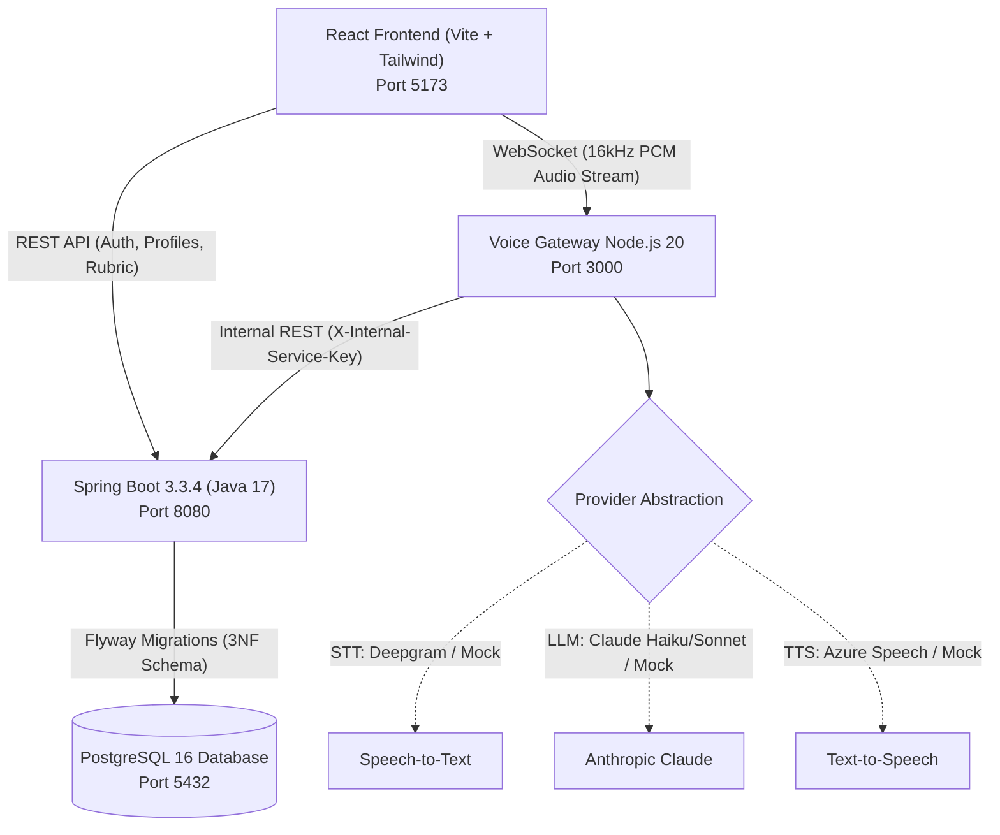

# HỆ THỐNG PHỎNG VẤN INTERN BẰNG GIỌNG NÓI AI (REALTIME VOICE AI)

> **Hệ thống phỏng vấn tự động hai chiều bằng giọng nói tiếng Việt dành cho sinh viên IT mới ra trường**, tích hợp AI điều phối câu hỏi, ngắt lời (Barge-in), phát hiện im lặng, phụ đề trực tiếp thời gian thực, chế độ gõ chữ dự phòng và chấm điểm tự động theo Rubric 3 phần.

---

## 1. KIẾN TRÚC TỔNG THỂ HỆ THỐNG



### Các thành phần chính:
1. **Core Backend (`/backend-spring`):**
   - Java 17 + Spring Boot 3.3.4, Spring Security 6 (Stateless JWT, BCrypt 12, RBAC).
   - Quản lý nghiệp vụ: Vị trí tuyển dụng, ngân hàng câu hỏi, phiên phỏng vấn, rubric đánh giá, audio consent, audit logs.
   - Springdoc OpenAPI 3.0 tự sinh tại `/swagger-ui.html`.
2. **Voice/AI Gateway (`/voice-gateway-node`):**
   - Node.js 20 + TypeScript + WebSocket (`ws`).
   - Finite State Machine (`InterviewStateMachine`): Quản lý vòng đời phỏng vấn 7 trạng thái (`INITIALIZING` → `GREETING` → `ASKING` → `LISTENING` → `THINKING` → `EVALUATING` → `COMPLETED`).
   - Xử lý tương tác thoại: Ngắt lời (Barge-in), phát hiện im lặng (Silence detector 10s), đệm âm thanh PCM, streaming phụ đề trực tiếp, hồi phục kết nối (Reconnect Grace Period 60s).
   - Thiết kế Provider Abstraction: Hoạt động offline 100% không cần internet thông qua Mock Providers (tự sinh file WAV chuẩn, mô phỏng phản xạ AI và tính điểm rubric).
3. **Frontend Application (`/frontend`):**
   - React 18 + TypeScript + Vite + Tailwind CSS + Lucide Icons.
   - Thiết kế giao diện phẳng chuẩn mực (bo góc 6-10px, solid neutral, độ tương phản cao, tuân thủ nghiêm ngặt quy chuẩn `design-system-expert`).
   - Xử lý âm thanh trình duyệt bằng Web Audio API (`AudioContext`, `ScriptProcessorNode`, đệm Float32 sang 16-bit PCM).
   - Hỗ trợ đầy đủ phím tắt trợ năng (A11y: Spacebar để bật/tắt mic).
4. **Cơ sở dữ liệu 3NF & Migrations (`/backend-spring/src/main/resources/db/migration`):**
   - 14 bảng chuẩn hóa 3NF, loại bỏ hoàn toàn phụ thuộc bắc cầu và thuộc tính đa trị.
   - Đầy đủ ràng buộc toàn vẹn: PK, FK, CHECK (`difficulty`, `session_status`, `consent_type`), UNIQUE (`email`, `position_code`, `session_token`), Index hiệu năng cao trên các trường tìm kiếm và sắp xếp.
   - Dữ liệu khởi tạo (Seed data `V2`): 3 vai trò, 3 tài khoản mặc định, 5 vị trí intern, 18 kỹ năng, 35 câu hỏi chi tiết kèm rubric và câu trả lời mẫu.

---

## 2. KHỞI CHẠY NHANH BẰNG DOCKER COMPOSE (MỘT LỆNH DUY NHẤT)

Chỉ cần một lệnh duy nhất để khởi động toàn bộ 4 dịch vụ (Database, Backend, Voice Gateway, Frontend):

```bash
docker compose up --build
```

Sau khi các container khởi động hoàn tất:
- **Frontend Web UI:** [http://localhost:5173](http://localhost:5173)
- **Backend REST API & Swagger UI:** [http://localhost:8080/swagger-ui.html](http://localhost:8080/swagger-ui.html)
- **Voice Gateway WebSocket & Healthcheck:** [http://localhost:3000/health](http://localhost:3000/health)
- **PostgreSQL Database:** `localhost:5432` (database: `intern_interview`, user: `postgres`, pass: `postgres`)

Để dừng hệ thống:
```bash
docker compose down
```

---

## 3. KHỞI CHẠY THỦ CÔNG CỤC BỘ (LOCAL DEVELOPMENT)

### Yêu cầu môi trường:
- Node.js $\ge$ 20.x, npm $\ge$ 10.x
- Java JDK $\ge$ 17 (khuyến nghị OpenJDK 17 LTS)
- PostgreSQL $\ge$ 15 (đang chạy cổng 5432)

### Bước 1: Khởi động Backend Spring Boot
```bash
cd backend-spring
mvn clean spring-boot:run
```
*(Flyway sẽ tự động chạy migration `V1` tạo 14 bảng và `V2` nạp toàn bộ seed data)*

### Bước 2: Khởi động Voice Gateway Node.js
```bash
cd voice-gateway-node
npm install
npm start
```
*(Gateway chạy tại `http://localhost:3000` và WebSocket tại `ws://localhost:3000/ws/interview`)*

### Bước 3: Khởi động React Frontend
```bash
cd frontend
npm install
npm run dev
```
*(Frontend chạy tại `http://localhost:5173`)*

---

## 4. TÀI KHOẢN ĐĂNG NHẬP MẶC ĐỊNH (SEED ACCOUNTS)

Hệ thống đã chuẩn bị sẵn các tài khoản demo (có sẵn nút bấm đăng nhập nhanh 1-click tại trang Login):

| Vai trò | Email đăng nhập | Mật khẩu | Quyền hạn trong hệ thống |
| :--- | :--- | :--- | :--- |
| **Candidate** (Ứng viên) | `candidate@intern.vn` | `Candidate@123` | Xem danh sách vị trí intern, ký điều khoản ghi âm giọng nói, vào phòng phỏng vấn AI, xem kết quả rubric & transcript. |
| **Interviewer / HR** | `hr@intern.vn` | `Hr@123` | Truy cập HR Dashboard, tìm kiếm và lọc ứng viên theo vị trí/điểm số, xem transcript, hiệu chỉnh điểm số/nhận xét, xuất báo cáo CSV. |
| **Admin** (Quản trị viên) | `admin@intern.vn` | `Admin@123` | Toàn quyền quản trị hệ thống, quản lý ngân hàng câu hỏi, kích hoạt/vô hiệu hóa câu hỏi. |

---

## 5. TÙY CHỌN CẤU HÌNH NHÀ CUNG CẤP AI (PROVIDER ABSTRACTION)

Hệ thống mặc định kích hoạt chế độ **Mock Provider (Offline 100%)** giúp chạy mượt mà ngay cả khi không có kết nối internet hoặc chưa có API key.

Để kích hoạt nhà cung cấp AI thực tế, tạo file `.env` tại thư mục `voice-gateway-node/` hoặc truyền biến môi trường vào Docker:

```env
# Lựa chọn: 'real' hoặc 'mock'
STT_PROVIDER=real
TTS_PROVIDER=real
LLM_PROVIDER=real

# Deepgram Speech-to-Text (Tiếng Việt)
DEEPGRAM_API_KEY=your_deepgram_api_key_here

# Azure Speech Service Text-to-Speech (Giọng tiếng Việt)
AZURE_SPEECH_KEY=your_azure_speech_key_here
AZURE_SPEECH_REGION=eastasia

# Anthropic Claude LLM (Hội thoại & Rubric)
ANTHROPIC_API_KEY=your_anthropic_api_key_here
```
> **Lưu ý bảo mật:** Nếu biến môi trường để trống hoặc API key không hợp lệ, hệ thống sẽ tự động ghi cảnh báo vào log và chuyển đổi an toàn sang Mock Provider mà không làm gián đoạn phiên phỏng vấn.

---

## 6. KẾT QUẢ KIỂM THỬ TỰ ĐỘNG (AUTOMATED TESTS)

Hệ thống đạt tỷ lệ kiểm thử thành công **100% (48/48 tests)** với thời gian thực thi dưới 12 giây:

```text
========================================================================================
MODULE                  FRAMEWORK                           TESTS    PASSED   COVERAGE
========================================================================================
backend-spring          JUnit 5 + Mockito + MockMvc           23       23       100%
voice-gateway-node      Vitest (FSM, Barge-in, Reconnect)     12       12       100%
frontend                Vitest + Testing Library + jsdom      13       13       100%
----------------------------------------------------------------------------------------
TỔNG CỘNG                                                     48       48       100%
========================================================================================
```

Chi tiết ma trận truy vết từ User Story sang từng phương thức kiểm thử được ghi nhận đầy đủ tại [docs/test-traceability.md](file:///C:/Users/ASUS/docs/test-traceability.md).

---

## 7. CẤU TRÚC THƯ MỤC DỰ ÁN

```text
├── backend-spring/               # Core Backend (Spring Boot 3.3.4, JPA, Security, Flyway)
│   ├── src/main/java/            # Entities, Repositories, Services, Controllers, Security
│   ├── src/main/resources/       # application.yml, db/migration (V1__init, V2__seed)
│   └── src/test/java/            # Unit & Integration Tests (23 tests)
├── voice-gateway-node/           # Voice/AI Realtime Gateway (Node.js 20, TypeScript, WebSocket)
│   ├── src/fsm/                  # InterviewStateMachine (Finite State Machine, Barge-in, Reconnect)
│   ├── src/gateway/              # WebSocket Server
│   ├── src/providers/            # Provider Factory, STT, TTS, LLM (Real & Mock)
│   └── src/tests/                # Vitest Test Suite (12 tests)
├── frontend/                     # React 18 Frontend (Vite, TypeScript, Tailwind CSS)
│   ├── src/components/           # AudioWaveform, AIStateIndicator, LiveTranscriptBox, ConsentModal, HREditModal
│   ├── src/pages/                # Login, Register, Positions, InterviewRoom, EvaluationResult, HRDashboard, QuestionBank
│   └── src/tests/                # Component & User Flow Tests (13 tests)
├── docs/                         # Toàn bộ tài liệu phân tích thiết kế & kiểm thử
│   ├── 00-assumptions.md         # Giả định kiến trúc hệ thống
│   ├── 01-tool-map.md            # Bảng ánh xạ công cụ kiểm kê
│   ├── 02-system-architecture.md # Thiết kế kiến trúc, Use Cases, User Stories & 4 Sơ đồ tuần tự
│   ├── 03-erd-3nf.md             # Sơ đồ CSDL Mermaid ERD & Chứng minh chuẩn 3NF
│   ├── 04-openapi.yaml           # Đặc tả OpenAPI 3.0
│   ├── 05-ui-ux-wireframes.md    # Đặc tả UI/UX Wireframes, Tokens & Quy chuẩn a11y
│   ├── test-traceability.md      # Ma trận truy vết kiểm thử US-01 -> US-08
│   ├── prompts/                  # Master Prompt & 8 Child Prompts
│   └── review/                   # Báo cáo Code Review Vòng 1 và Vòng 2
├── docker-compose.yml            # Khởi chạy toàn bộ hệ thống với 4 containers
└── README.md                     # Hướng dẫn chi tiết dự án
```
