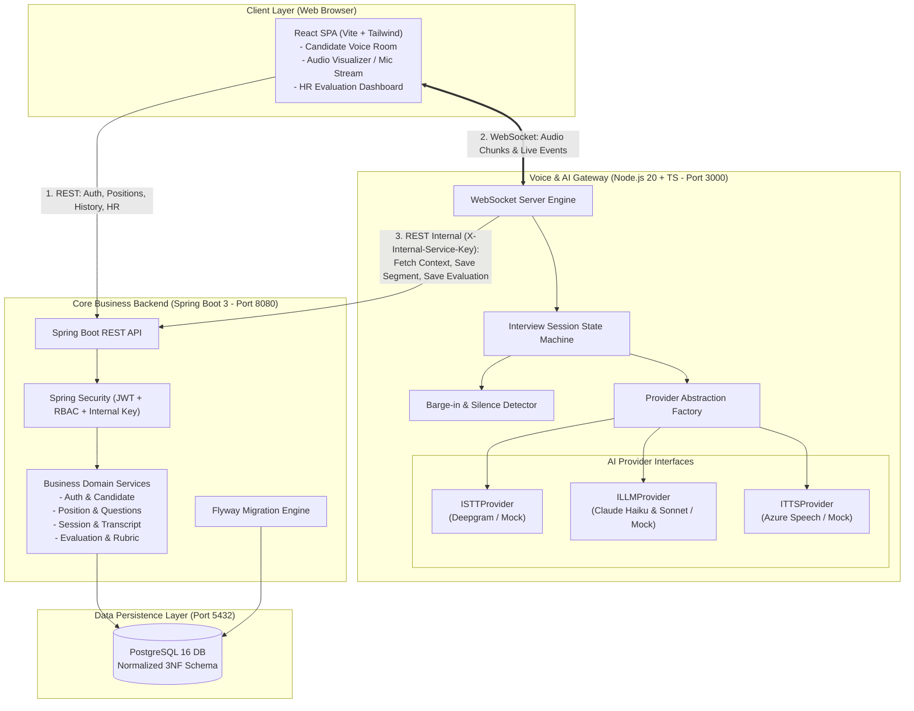
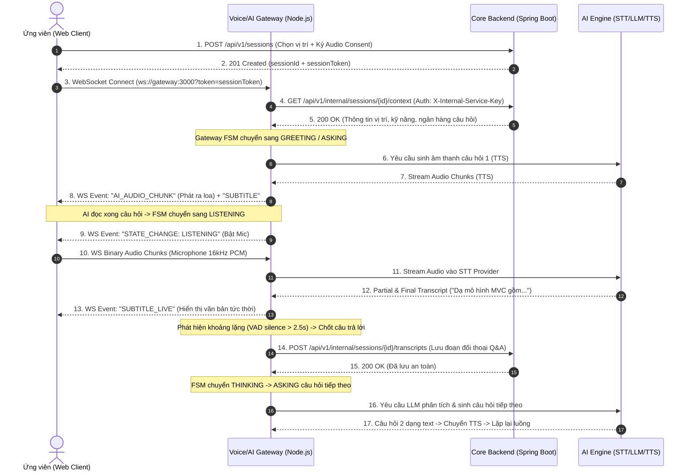
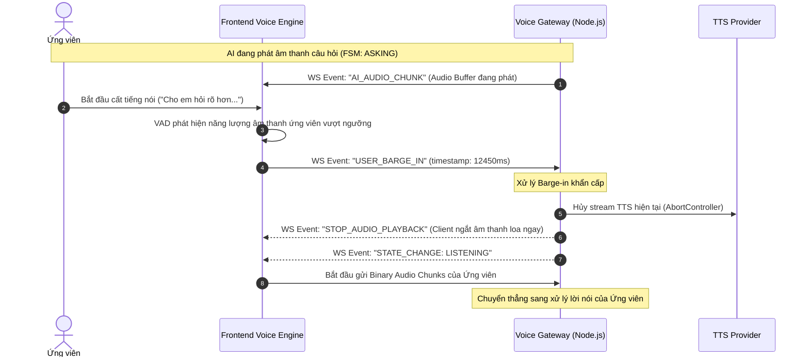
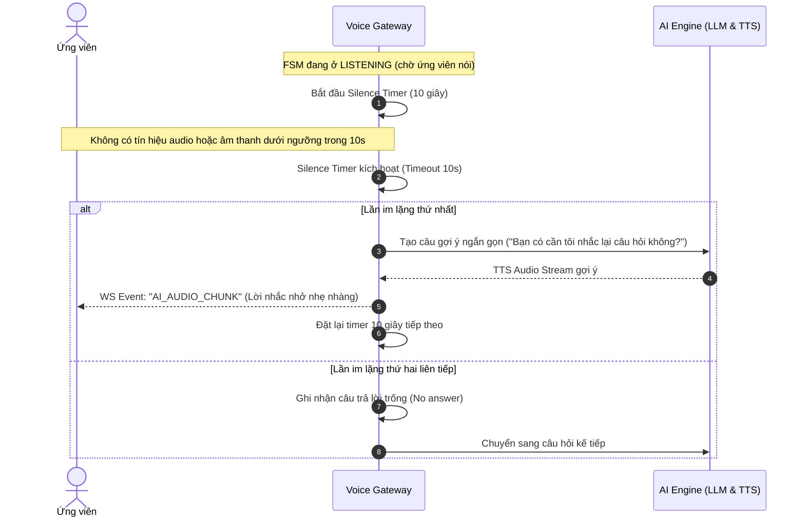
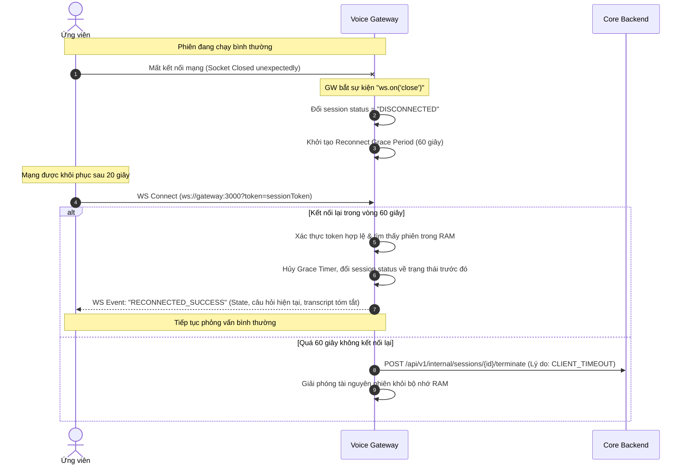

# TÀI LIỆU PHÂN TÍCH VÀ THIẾT KẾ KIẾN TRÚC HỆ THỐNG
**Dự án:** Hệ thống phỏng vấn intern cho sinh viên IT mới ra trường (Voice AI Interview System)  
**Mã tài liệu:** `DOCS-02-SYSTEM-ARCHITECTURE`  
**Phiên bản:** 1.0.0  
**Tác giả:** Solution Architect + Tech Lead  
**Trạng thái:** Được phê duyệt thực thi  

---

## 1. TỔNG QUAN KIẾN TRÚC HỆ THỐNG (SYSTEM OVERVIEW)

Hệ thống được thiết kế theo mô hình **Kiến trúc Phân tán Lai (Hybrid Distributed Architecture)**:
- **Core Business Backend (Spring Boot 3 + Java 21):** Đóng vai trò hạt nhân quản lý dữ liệu, phân quyền xác thực (JWT/RBAC), lưu trữ trạng thái hồ sơ, ngân hàng câu hỏi, phiên phỏng vấn, transcript phân đoạn và kết quả đánh giá theo chuẩn 3NF trên PostgreSQL.
- **Voice/AI Gateway (Node.js 20 + TypeScript):** Đóng vai trò máy chủ tương tác thời gian thực chuyên biệt xử lý kết nối WebSocket độ trễ thấp, streaming âm thanh hai chiều (binary chunks), điều phối pipeline STT $\rightarrow$ LLM $\rightarrow$ TTS, quản lý State Machine phiên phỏng vấn và cơ chế ngắt lời (Barge-in).
- **Candidate & HR Client (React + Vite + TypeScript + Tailwind):** Ứng dụng Single Page Application tương tác đồng thời với Spring Boot qua REST API và với Node.js Gateway qua giao thức WebSocket.

### Sơ đồ Khối Thành phần (Component Diagram)



---

## 2. PHÂN TÍCH YÊU CẦU NGHIỆP VỤ (USE CASES & USER STORIES)

### 2.1. Danh mục Use Cases Cốt lõi
- **UC-01 (Đăng ký & Xác thực):** Đăng ký tài khoản, đăng nhập cấp JWT, xác định vai trò Candidate / HR / Admin.
- **UC-02 (Quản lý Vị trí & Hồ sơ):** Xem 5 vị trí intern, thiết lập hồ sơ kỹ năng, cấp Audio Consent.
- **UC-03 (Phiên Phỏng vấn Thoại AI):** Khởi tạo WebSocket, trao đổi giọng nói hai chiều, phụ đề realtime, ngắt lời (Barge-in), chuyển chế độ Text Fallback khi cần.
- **UC-04 (Tự động Đánh giá theo Rubric):** LLM phân tích toàn bộ transcript theo 3 tiêu chí Rubric (Kỹ thuật 40%, Tư duy 30%, Giao tiếp 30%) và sinh nhận xét.
- **UC-05 (HR Dashboard & Quản lý Kết quả):** HR xem danh sách, lọc điểm, duyệt transcript chi tiết, hiệu chỉnh điểm và xuất báo cáo.
- **UC-06 (Quản lý Ngân hàng Câu hỏi):** Admin/HR thêm, sửa, phân loại câu hỏi theo vị trí, kỹ năng và độ khó (Easy, Medium, Hard).

### 2.2. Danh sách User Stories & Acceptance Criteria (Chuẩn Gherkin)

#### [US-01] Đăng ký & Đăng nhập phân quyền (JWT + RBAC)
- **Là một** người dùng (Candidate hoặc HR),  
  **Tôi muốn** đăng ký tài khoản và đăng nhập vào hệ thống bằng email và mật khẩu an toàn,  
  **Để** có thể truy cập đúng các chức năng tương ứng với vai trò của mình.
- **Acceptance Criteria (Gherkin):**
  ```gherkin
  Scenario: Đăng ký tài khoản Candidate thành công
    Given Người dùng cung cấp email hợp lệ "candidate@intern.vn", mật khẩu "P@ssw0rd123" và vai trò "ROLE_CANDIDATE"
    When Gửi yêu cầu POST tới "/api/v1/auth/register"
    Then Hệ thống mã hóa mật khẩu bằng BCrypt (cost factor 12)
    And Trả về mã HTTP 201 Created cùng thông tin người dùng (không trả về hash mật khẩu)

  Scenario: Đăng nhập thất bại do sai mật khẩu
    Given Tài khoản "candidate@intern.vn" tồn tại trong hệ thống
    When Gửi yêu cầu POST tới "/api/v1/auth/login" với mật khẩu sai
    Then Hệ thống trả về HTTP 401 Unauthorized theo chuẩn RFC 7807 với thông điệp "Bad credentials"
  ```

#### [US-02] Đăng ký phỏng vấn & Chấp thuận Ghi âm (Audio Consent)
- **Là một** ứng viên intern,  
  **Tôi muốn** chọn một vị trí ứng tuyển và ký thỏa thuận chấp thuận ghi âm giọng nói trước khi vào phỏng vấn,  
  **Để** đảm bảo quyền riêng tư và tuân thủ quy định bảo vệ dữ liệu cá nhân.
- **Acceptance Criteria:**
  ```gherkin
  Scenario: Ký thỏa thuận ghi âm và tạo phiên phỏng vấn
    Given Ứng viên đã đăng nhập và chọn vị trí "Java Backend Intern"
    When Ứng viên tích chọn "Tôi đồng ý ghi âm giọng nói phục vụ đánh giá" và nhấn "Bắt đầu phỏng vấn"
    Then Hệ thống ghi một bản ghi vào bảng "consents" (thời điểm, IP, phiên bản thỏa thuận)
    And Khởi tạo phiên phỏng vấn mới trong bảng "interview_sessions" với trạng thái "SCHEDULED"
    And Cấp một "session_token" tạm thời để kết nối WebSocket Gateway
  ```

#### [US-03] Tương tác Phỏng vấn Giọng nói Hai chiều với AI (Realtime Voice)
- **Là một** ứng viên trong phòng phỏng vấn,  
  **Tôi muốn** nghe AI đọc câu hỏi bằng giọng tiếng Việt tự nhiên và trả lời trực tiếp qua micro,  
  **Để** có trải nghiệm phỏng vấn chân thực như với người thật.
- **Acceptance Criteria:**
  ```gherkin
  Scenario: Luồng hỏi và đáp bình thường
    Given Ứng viên đã kết nối WebSocket thành công tới Gateway với session_token hợp lệ
    When Phiên chuyển sang trạng thái "ASKING", AI tổng hợp giọng nói qua TTS và stream audio chunk tới client
    Then Client phát âm thanh câu hỏi và hiển thị visualizer "AI Speaking"
    When AI nói xong câu hỏi, phiên chuyển sang "LISTENING" và micro ứng viên được kích hoạt
    When Ứng viên nói câu trả lời, audio chunks được gửi stream lên Gateway và STT chuyển thành văn bản realtime
    When Ứng viên dừng nói quá 2.5 giây, Gateway chốt transcript và chuyển trạng thái "THINKING" để hỏi tiếp
  ```

#### [US-04] Cơ chế Ngắt lời Thông minh (Barge-in Handling)
- **Là một** ứng viên,  
  **Tôi muốn** có thể ngắt lời AI khi AI đang nói (ví dụ khi đã hiểu câu hỏi hoặc muốn làm rõ),  
  **Để** cuộc trò chuyện diễn ra linh hoạt, không bị cưỡng ép phải chờ AI nói hết.
- **Acceptance Criteria:**
  ```gherkin
  Scenario: Ứng viên ngắt lời AI khi AI đang đọc câu hỏi
    Given AI đang ở trạng thái "ASKING" và đang stream các gói audio TTS về client
    When Client phát hiện âm thanh từ micro ứng viên vượt ngưỡng âm lượng (VAD threshold)
    And Gửi event "USER_BARGE_IN" lên Gateway kèm timestamp
    Then Gateway ngay lập tức hủy tác vụ stream TTS của câu hỏi đó
    And Gửi event "STOP_AUDIO_PLAYBACK" xuống client để ngắt loa ngay lập tức
    And Chuyển State Machine của phiên sang trạng thái "LISTENING"
  ```

#### [US-05] Xử lý Mất kết nối & Khôi phục Phiên (Reconnect & State Recovery)
- **Là một** ứng viên gặp sự cố mạng chập chờn,  
  **Tôi muốn** hệ thống giữ nguyên ngữ cảnh phiên trong vòng 60 giây khi bị rớt kết nối,  
  **Để** có thể kết nối lại và tiếp tục phỏng vấn mà không bị mất dữ liệu trước đó.
- **Acceptance Criteria:**
  ```gherkin
  Scenario: Khôi phục phiên sau khi mất mạng
    Given Phiên phỏng vấn đang diễn ra ở câu hỏi số 3
    When Kết nối WebSocket bị đứt đột ngột
    Then Gateway chuyển trạng thái phiên sang "DISCONNECTED" và đặt đồng hồ đếm ngược 60 giây
    When Ứng viên kết nối lại WebSocket với cùng session_token trong 40 giây
    Then Gateway phục hồi lại State Machine, gửi lại ngữ cảnh câu hỏi hiện tại và tiếp tục phỏng vấn
  ```

#### [US-06] Chế độ Nhập văn bản Dự phòng (Text Chat Fallback)
- **Là một** ứng viên gặp trục trặc về micro hoặc trình duyệt không cấp quyền thiết bị,  
  **Tôi muốn** chuyển sang chế độ gõ phím trả lời bằng văn bản,  
  **Để** phiên phỏng vấn vẫn được hoàn thành mà không bị hủy bỏ.
- **Acceptance Criteria:**
  ```gherkin
  Scenario: Chuyển đổi sang Text Chat Fallback
    Given Ứng viên nhấn nút "Chuyển sang gõ chữ" trên giao diện phòng phỏng vấn
    When Client gửi event "SWITCH_TO_TEXT_MODE" qua WebSocket
    Then Gateway chuyển kênh nhận input từ STT audio stream sang Text Payload
    And AI vẫn đặt câu hỏi và chấm điểm theo đúng rubric tiêu chuẩn
  ```

#### [US-07] Tự động Chấm điểm Rubric & Phản hồi Toàn diện
- **Là một** nhà tuyển dụng / ứng viên,  
  **Tôi muốn** hệ thống tự động chấm điểm phiên phỏng vấn theo rubric 3 phần ngay khi phiên kết thúc,  
  **Để** có bảng đánh giá khách quan, chi tiết và có thể hành động được.
- **Acceptance Criteria:**
  ```gherkin
  Scenario: Hoàn thành phỏng vấn và sinh đánh giá
    Given Ứng viên trả lời xong câu hỏi cuối cùng hoặc nhấn "Kết thúc phỏng vấn"
    When Gateway chuyển trạng thái sang "EVALUATING" và gọi LLM (Claude Sonnet / Mock) với toàn bộ transcript
    Then LLM trả về cấu trúc JSON gồm: điểm Kỹ thuật (thang 10), Tư duy (thang 10), Giao tiếp (thang 10), điểm Tổng kết và nhận xét chi tiết
    And Gateway gọi REST nội bộ đẩy kết quả đánh giá về Spring Boot lưu vào bảng "evaluations"
    And Phiên phỏng vấn chuyển trạng thái thành "COMPLETED"
  ```

#### [US-08] HR Dashboard Quản lý Ứng viên & Hiệu chỉnh Điểm
- **Là một** HR / Chuyên gia phỏng vấn,  
  **Tôi muốn** xem danh sách các ứng viên, lọc theo điểm số/vị trí, đọc toàn văn transcript và điều chỉnh điểm số thủ công,  
  **Để** đưa ra quyết định tuyển dụng chính xác cuối cùng.
- **Acceptance Criteria:**
  ```gherkin
  Scenario: HR hiệu chỉnh điểm và nhập nhận xét
    Given HR đã đăng nhập và truy cập trang chi tiết đánh giá của ứng viên
    When HR điều chỉnh điểm Kỹ thuật từ 7 lên 8 và nhập ghi chú "Ứng viên có tư duy tốt về concurrency"
    And Gửi yêu cầu PUT tới "/api/v1/evaluations/{id}"
    Then Hệ thống cập nhật bảng "evaluations" với trường "hr_override_scores" và ghi nhật ký vào "audit_logs"
  ```

---

## 3. SƠ ĐỒ TUẦN TỰ TƯƠNG TÁC CHI TIẾT (SEQUENCE DIAGRAMS)

### 3.1. Luồng Tương tác Bình thường (Normal Voice Flow)



---

### 3.2. Luồng Ngắt lời Thông minh (Barge-in Flow)



---

### 3.3. Luồng Phát hiện Im lặng (Silence Timeout Flow)



---

### 3.4. Luồng Mất kết nối & Khôi phục Phiên (Reconnect Flow)



---

## 4. GIAO THỨC BẢO MẬT VÀ GIAO TIẾP LIÊN DỊCH VỤ

### 4.1. Giao thức Spring Boot $\leftrightarrow$ Node.js Gateway (Internal Service Communication)
- **Phương thức:** HTTP/1.1 RESTful qua mạng nội bộ Docker (`http://backend-spring:8080`).
- **Cơ chế xác thực:** Header chia sẻ bí mật `X-Internal-Service-Key` được cấu hình qua biến môi trường `INTERNAL_SERVICE_KEY`.
- **Bảo mật:**
  - Bộ lọc `InternalServiceAuthFilter` trên Spring Boot chặn toàn bộ các yêu cầu tới `/api/v1/internal/**` nếu thiếu hoặc sai key.
  - Phản hồi HTTP 403 Forbidden theo chuẩn RFC 7807 nếu vi phạm xác thực.
- **Danh sách Endpoints Nội bộ:**
  - `GET /api/v1/internal/sessions/{id}/context`: Gateway lấy thông tin vị trí, kỹ năng và câu hỏi khi khởi động phiên.
  - `POST /api/v1/internal/sessions/{id}/transcripts`: Gateway lưu từng cặp câu hỏi - câu trả lời sau mỗi vòng đối thoại.
  - `POST /api/v1/internal/sessions/{id}/evaluations`: Gateway gửi bảng điểm rubric và nhận xét AI khi phiên kết thúc.
  - `POST /api/v1/internal/sessions/{id}/terminate`: Gateway báo kết thúc phiên bất thường (timeout / drop).

### 4.2. Giao thức Client $\leftrightarrow$ Node.js Gateway (WebSocket Realtime)
- **Đường dẫn:** `ws://localhost:3000/ws/interview`
- **Xác thực ban đầu (Handshake Authentication):** Truyền JWT `sessionToken` qua query string `?token=...` hoặc Sec-WebSocket-Protocol.
- **Định dạng dữ liệu:**
  - **Downlink (Gateway $\rightarrow$ Client):**
    - Text Frames (JSON): `{ "event": "STATE_CHANGE", "payload": { "state": "LISTENING" } }`, `{ "event": "SUBTITLE", "payload": { "text": "...", "speaker": "AI" } }`.
    - Binary Frames: Gói âm thanh nhị phân (Int16 PCM / MP3 chunk) phục vụ Audio Player.
  - **Uplink (Client $\rightarrow$ Gateway):**
    - Binary Frames: Microphone audio stream (16kHz, 16-bit Mono PCM).
    - Text Frames (JSON): `{ "event": "USER_BARGE_IN" }`, `{ "event": "TEXT_ANSWER", "payload": { "text": "..." } }`.

---

## 5. CHIẾN LƯỢC XỬ LÝ PHI CHỨC NĂNG (NON-FUNCTIONAL SPECS)

1. **Lọc và Ẩn Thông tin Cá nhân Nhạy cảm (PII Sanitization):**
   - Trước khi gửi lịch sử hội thoại lên AI Engine (Claude), Gateway chạy thuật toán regex làm mờ số điện thoại (`(\+84|0)\d{9,10}` $\rightarrow$ `[SỐ_ĐIỆN_THOẠI]`) và email (`[\w.-]+@[\w.-]+\.\w+` $\rightarrow$ `[EMAIL]`).
   - Tuyệt đối không gửi thông tin định danh cá nhân (họ tên đầy đủ, ngày sinh, địa chỉ) vào system prompt của AI.
2. **Kiểm soát Tần suất Truy cập (Rate Limiting):**
   - Áp dụng Bucket Token Rate Limiting trên các endpoint xác thực (`/api/v1/auth/*`): Tối đa 10 requests / phút / IP.
   - Giới hạn tạo phiên phỏng vấn mới: Tối đa 3 phiên phỏng vấn / ngày / tài khoản candidate để chống lãng phí token LLM/STT.
3. **Nhật ký Hoạt động (Audit Logging):**
   - Mọi hành động nhạy cảm của HR (sửa điểm, ghi đè nhận xét, xóa ứng viên) đều được ghi nhận vào bảng `audit_logs` với đầy đủ timestamp, user_id, action, old_value, new_value, và IP.
