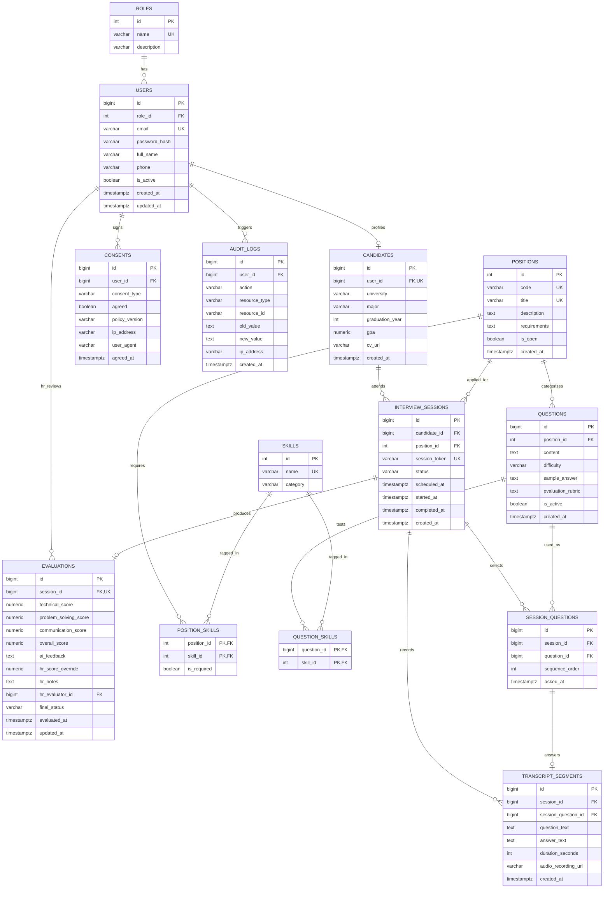

# THIẾT KẾ CƠ SỞ DỮ LIỆU CHUẨN HÓA 3NF & CHIẾN LƯỢC INDEXING
**Dự án:** Hệ thống phỏng vấn intern cho sinh viên IT mới ra trường (Voice AI Interview System)  
**Mã tài liệu:** `DOCS-03-ERD-3NF`  
**Phiên bản:** 1.0.0  
**Tác giả:** Solution Architect + Database Specialist  

---

## 1. SƠ ĐỒ QUAN HỆ THỰC THỂ (ERD MERMAID)

---

## 2. CHỨNG MINH TOÁN HỌC & LOGIC CHUẨN HÓA 3NF (NORMALIZATION PROOF)

Để đảm bảo cơ sở dữ liệu đạt chuẩn 3NF tuyệt đối, mọi quan hệ (bảng) phải thỏa mãn liên tiếp 3 dạng chuẩn:

### 2.1. Chuẩn Hóa Dạng 1 (1NF - First Normal Form)
- **Định nghĩa:** Bảng đạt 1NF khi mọi thuộc tính đều chứa các giá trị nguyên tử (Atomic values), không chứa thuộc tính đa trị (Multi-valued attributes) và không có nhóm thuộc tính lặp lại (Repeating groups).
- **Chứng minh trong thiết kế:**
  1. *Không lưu mảng kỹ năng dạng chuỗi:* Thay vì lưu `skills = 'Java, Spring, SQL'` trong bảng `positions` hoặc `questions`, hệ thống tách thành bảng `skills` riêng biệt và sử dụng hai bảng liên kết trung gian `position_skills(position_id, skill_id)` và `question_skills(question_id, skill_id)`.
  2. *Không lặp cột câu hỏi:* Không sử dụng `question_1, question_2, question_3` trong bảng `interview_sessions`. Toàn bộ danh sách câu hỏi trong phiên được mô hình hóa qua bảng quan hệ `session_questions` với khóa ngoại và số thứ tự `sequence_order`.
  3. *Mọi thuộc tính scalar đều đơn trị:* Tên, email, số điện thoại, điểm số, thời gian đều là giá trị nguyên tử đơn nhất.
  $\Rightarrow$ **Kết luận:** Toàn bộ 14 bảng đạt chuẩn 1NF.

### 2.2. Chuẩn Hóa Dạng 2 (2NF - Second Normal Form)
- **Định nghĩa:** Bảng đạt 2NF khi đã đạt 1NF và mọi thuộc tính phi khóa (Non-prime attribute) đều phụ thuộc hàm toàn phần (Full Functional Dependency) vào toàn bộ khóa chính, không phụ thuộc vào một phần của khóa chính (Partial Dependency).
- **Chứng minh trong thiết kế:**
  1. Các bảng có khóa chính đơn (`users`, `candidates`, `positions`, `questions`, `interview_sessions`, `transcript_segments`, `evaluations`, v.v.): Vì khóa chính chỉ gồm 1 cột duy nhất, không thể tồn tại phụ thuộc một phần vào khóa chính $\Rightarrow$ Tự động đạt 2NF.
  2. Các bảng có khóa chính hợp thành (Composite Primary Key):
     - `position_skills`: Khóa chính là `(position_id, skill_id)`. Thuộc tính phi khóa duy nhất là `is_required`. Mức độ bắt buộc `is_required` là quan hệ giữa vị trí cụ thể và kỹ năng cụ thể (ví dụ: đối với Java Intern thì Java là bắt buộc `true`, nhưng đối với Data Intern thì Java có thể là `false`). Do đó `is_required` phụ thuộc hàm toàn phần vào cả `(position_id, skill_id)`.
     - `question_skills`: Khóa chính là `(question_id, skill_id)`. Bảng này không chứa thuộc tính phi khóa nào khác $\Rightarrow$ Tự động đạt 2NF.
  $\Rightarrow$ **Kết luận:** Toàn bộ 14 bảng đạt chuẩn 2NF.

### 2.3. Chuẩn Hóa Dạng 3 (3NF - Third Normal Form)
- **Định nghĩa:** Bảng đạt 3NF khi đã đạt 2NF và không có thuộc tính phi khóa nào phụ thuộc bắc cầu (Transitive Dependency) vào khóa chính thông qua một thuộc tính phi khóa khác ($X \rightarrow Y$ và $Y \rightarrow Z$).
- **Chứng minh trong thiết kế:**
  1. *Tách biệt User và Candidate:* Trong bảng `candidates`, thông tin tài khoản (email, mật khẩu, họ tên, vai trò) không được lưu lặp lại mà tách riêng vào bảng `users`. Nếu để chung, các thông tin học vấn sẽ phụ thuộc vào User, gây phụ thuộc bắc cầu.
  2. *Tách biệt Session và Evaluation:* Điểm số đánh giá (`technical_score`, `overall_score`) phụ thuộc vào buổi phỏng vấn nhưng kết quả này là một đối tượng nghiệp vụ độc lập được sinh ra sau khi kết thúc phiên. Việc tách riêng bảng `evaluations` với khóa ngoại `session_id` giúp tránh việc các cột điểm số bị `NULL` trong suốt thời gian phiên phỏng vấn đang diễn ra, loại bỏ phụ thuộc bắc cầu giữa trạng thái phiên và điểm số.
  3. *Tách biệt Transcript Segments:* Nội dung câu hỏi và câu trả lời theo từng lượt (turn-by-turn) không được gộp vào bảng `interview_sessions` (tránh phụ thuộc bắc cầu và dư thừa lặp). Mỗi segment là một bản ghi độc lập phụ thuộc vào `session_id` và `session_question_id`.
  4. *Vai trò (Role):* Lưu `role_id` tham chiếu tới bảng `roles`, không lưu chuỗi vai trò kèm mô tả quyền trong bảng `users`.
  $\Rightarrow$ **Kết luận:** Toàn bộ 14 bảng đạt chuẩn 3NF tuyệt đối, loại bỏ hoàn toàn dư thừa dữ liệu và dị thường khi cập nhật (Update/Delete Anomaly).

---

## 3. CHIẾN LƯỢC ĐÁNH CHỈ MỤC (INDEXING STRATEGY)

Để tối ưu hóa hiệu năng truy vấn trong điều kiện tải cao và loại bỏ nguy cơ Full Table Scan, các chỉ mục được thiết lập dựa trên tần suất truy vấn thực tế:

| Tên Bảng | Tên Chỉ mục (Index) | Kiểu Index | Cột được đánh chỉ mục | Mục đích & Truy vấn hưởng lợi |
| :--- | :--- | :---: | :--- | :--- |
| `users` | `idx_users_email` | B-Tree (UNIQUE) | `email` | Xác thực đăng nhập `WHERE email = ?` tốc độ $O(\log N)$ |
| `users` | `idx_users_role_id` | B-Tree | `role_id` | Lọc danh sách người dùng theo vai trò |
| `positions` | `idx_positions_code` | B-Tree (UNIQUE) | `code` | Tra cứu vị trí theo mã danh mục nhanh |
| `questions` | `idx_questions_pos_diff` | Composite B-Tree | `(position_id, difficulty)` | AI Gateway bốc câu hỏi ngẫu nhiên theo vị trí và độ khó |
| `interview_sessions`| `idx_sessions_candidate` | B-Tree | `candidate_id` | Xem lịch sử phỏng vấn của ứng viên `WHERE candidate_id = ?` |
| `interview_sessions`| `idx_sessions_status` | B-Tree | `status` | HR Dashboard lọc các phiên đang chạy / hoàn thành |
| `interview_sessions`| `idx_sessions_token` | B-Tree (UNIQUE) | `session_token` | WebSocket Handshake xác thực phiên tức thời |
| `session_questions` | `idx_sess_ques_order` | Composite B-Tree | `(session_id, sequence_order)` | Gateway lấy câu hỏi tiếp theo theo thứ tự |
| `transcript_segments`| `idx_transcripts_session` | B-Tree | `session_id` | Tải toàn văn transcript phiên để hiển thị hoặc chấm điểm |
| `evaluations` | `idx_eval_session` | B-Tree (UNIQUE) | `session_id` | Tra cứu kết quả đánh giá của một phiên |
| `evaluations` | `idx_eval_scores` | Composite B-Tree | `(overall_score DESC, final_status)`| HR Dashboard sắp xếp xếp hạng và lọc kết quả tuyển dụng |
| `consents` | `idx_consents_user_type`| Composite B-Tree | `(user_id, consent_type)` | Kiểm tra quyền ghi âm trước khi cho phép vào phòng thoại |
| `audit_logs` | `idx_audit_resource` | Composite B-Tree | `(resource_type, resource_id)` | Truy vết lịch sử chỉnh sửa điểm của HR |

---

## 4. QUY TẮC RÀNG BUỘC TOÀN VẸN DỮ LIỆU
1. **Khóa Ngoại & Hành Vi Xóa:**
   - Khi xóa `positions`: Không cho phép xóa (`ON DELETE RESTRICT`) nếu đã có `questions` hoặc `interview_sessions` liên kết.
   - Khi xóa `interview_sessions`: Toàn bộ `session_questions`, `transcript_segments` và `evaluations` liên quan được tự động xóa theo dây chuyền (`ON DELETE CASCADE`) để dọn sạch dữ liệu mồ côi khi hủy phiên thử nghiệm.
2. **Ràng buộc Kiểm tra Miền Giá trị (`CHECK Constraints`):**
   - Điểm số trong `evaluations`: `CHECK (score >= 0.0 AND score <= 10.0)`.
   - Độ khó câu hỏi trong `questions`: `CHECK (difficulty IN ('EASY', 'MEDIUM', 'HARD'))`.
   - Trạng thái phiên trong `interview_sessions`: `CHECK (status IN ('SCHEDULED', 'IN_PROGRESS', 'COMPLETED', 'CANCELLED', 'TIMEOUT'))`.
   - Trạng thái đánh giá trong `evaluations`: `CHECK (final_status IN ('PASSED', 'FAILED', 'UNDER_REVIEW'))`.
