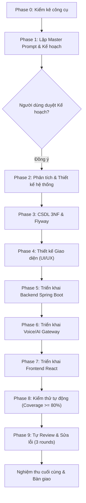

# MASTER PROMPT – HỆ THỐNG PHỎNG VẤN INTERN BẰNG GIỌNG NÓI AI
**Dự án:** Hệ thống phỏng vấn intern cho sinh viên IT mới ra trường (Voice AI Interview System)  
**Mã tài liệu:** `DOCS-PROMPT-00-MASTER`  
**Phiên bản:** 1.0.0  
**Tác giả:** Tech Lead + Solution Architect + QA Lead Tự trị  

---

## 1. MỤC TIÊU DỰ ÁN
Xây dựng một hệ thống hoàn chỉnh phục vụ phỏng vấn tuyển dụng thực tập sinh (intern) ngành Công nghệ Thông tin mới ra trường, tích hợp Trí tuệ Nhân tạo (AI Interviewer) có khả năng tương tác hai chiều bằng giọng nói tiếng Việt thời gian thực (Realtime Voice AI). Hệ thống tự động đặt câu hỏi theo vị trí chuyên môn, lắng nghe câu trả lời qua micro của ứng viên, đối thoại đào sâu (follow-up questions), ghi nhận toàn văn transcript và tự động chấm điểm theo khung tiêu chí (Rubric Evaluation).

---

## 2. PHẠM VI HỆ THỐNG

### 2.1. Phạm vi Chức năng (Functional Scope)
1. **Quản lý Vị trí Tuyển dụng & Ngân hàng Câu hỏi:**
   - Hỗ trợ các vị trí phổ biến: Java Backend Intern, Node.js Backend Intern, Frontend React Intern, QA/QC Intern, Data/AI Intern.
   - Ngân hàng câu hỏi phân loại theo kỹ năng chuyên môn (Skill tag) và cấp độ nhận thức/độ khó (Easy, Medium, Hard).
2. **Cổng Thông tin Ứng viên (Candidate Portal):**
   - Đăng ký, đăng nhập, quản lý hồ sơ cá nhân, học vấn và kỹ năng.
   - Chọn vị trí, đặt lịch phỏng vấn và truy cập phòng phỏng vấn trực tuyến.
   - Xem kết quả đánh giá, điểm thành phần theo rubric, transcript chi tiết và lời khuyên phát triển kỹ năng.
3. **Phòng Phỏng vấn Thoại Trực tiếp với AI (Realtime Voice Interview Room):**
   - Trực quan hóa tương tác: chỉ báo trạng thái AI (Nói - Nghe - Suy nghĩ), sóng âm âm thanh (Audio Visualizer), hiển thị phụ đề thời gian thực.
   - AI đặt câu hỏi mở đầu, lắng nghe phản hồi của ứng viên qua microphone (Streaming STT), phân tích ngữ cảnh để hỏi câu đào sâu tiếp theo.
   - Cơ chế ngắt lời thông minh (Barge-in): Ứng viên nói ngắt khi AI đang nói thì AI tự động dừng phát âm thanh.
   - Phát hiện im lặng (Silence Detection): Nhắc nhở hoặc chuyển câu khi ứng viên im lặng quá lâu.
   - Hỗ trợ chế độ nhập văn bản dự phòng (Text Chat Fallback) khi ứng viên không có micro hoặc thiết bị gặp lỗi.
4. **Hệ thống Chấm điểm Tự động (Auto Evaluation & Rubric Scoring):**
   - Đánh giá đa chiều dựa trên khung Rubric: Kiến thức Kỹ thuật (Technical Knowledge - 40%), Tư duy Giải quyết Vấn đề (Problem Solving - 30%), Kỹ năng Giao tiếp & Trình bày (Communication - 30%).
   - Tự động sinh nhận xét chi tiết: Điểm mạnh (Strengths), Điểm yếu (Weaknesses), Khuyến nghị cải thiện (Actionable Advice).
5. **Dashboard Quản trị & Nhà tuyển dụng (HR/Interviewer Dashboard):**
   - Danh sách ứng viên, tìm kiếm, lọc theo vị trí, điểm số, trạng thái (Passed, Failed, Under Review).
   - Xem chi tiết từng phiên phỏng vấn: toàn bộ transcript có gắn nhãn câu hỏi/câu trả lời, điểm gợi ý từ AI.
   - HR có quyền điều chỉnh điểm số thủ công và nhập ghi chú phỏng vấn viên.
   - Xuất dữ liệu báo cáo danh sách ứng viên (JSON / CSV).

### 2.2. Phạm vi Phi chức năng (Non-Functional Scope)
- **Bảo mật & Phân quyền:** JWT + Refresh Token, mã hóa mật khẩu BCrypt, phân quyền RBAC (`ROLE_CANDIDATE`, `ROLE_INTERVIEWER`, `ROLE_ADMIN`).
- **Quyền riêng tư & PII:** Thu thập văn bản đồng thuận ghi âm (Audio Consent) trước khi cấp quyền mở WebSocket; ẩn/mã hóa PII (email, số điện thoại) trong log và payload gửi LLM.
- **Khả năng chịu lỗi:** Xử lý rớt mạng WebSocket (reconnect trong 60 giây khôi phục lại phiên), lưu trữ phân đoạn transcript ngay khi hoàn thành câu trả lời để không mất dữ liệu.
- **Provider Abstraction:** Kiến trúc cắm rút cho STT, TTS, LLM thông qua interface trừu tượng. Tự động chuyển đổi sang Mock Provider nếu thiếu API Key trong `.env` kèm cảnh báo log.

---

## 3. RÀNG BUỘC KỸ THUẬT & KIẾN TRÚC
1. **Backend Nghiệp vụ Cốt lõi:** Java 21 + Spring Boot 3.x (Spring Web, Spring Security, Spring Data JPA, Validation, Flyway Migration). Cổng `8080`.
2. **Voice/AI Gateway:** Node.js 20 + TypeScript, WebSocket server cho streaming audio hai chiều. Cổng `3000`. Giao tiếp với Spring Boot qua REST API nội bộ có xác thực Service Token bí mật.
3. **Cơ sở dữ liệu:** PostgreSQL 16+, tuân thủ nghiêm ngặt chuẩn 3NF, không phụ thuộc bắc cầu, không cột đa trị. Cổng `5432`.
4. **Frontend:** React 18+ với TypeScript, Vite, Tailwind CSS. Cổng `5173`. Giao diện phẳng, chuẩn bo góc 6-10px, không gradient/glassmorphism sặc sỡ theo `design-system-expert`.
5. **Đóng gói & Chạy nhanh:** `docker-compose.yml` điều phối toàn bộ các dịch vụ trên local chỉ với một lệnh `docker compose up`.

---

## 4. DEFINITION OF DONE (DoD) TOÀN DỰ ÁN
Một sản phẩm được coi là hoàn thành (Done) khi và chỉ khi đáp ứng tất cả các tiêu chí sau:
1. **Kiến trúc & Tài liệu:**
   - Đầy đủ tài liệu tại `/docs`: `00-assumptions.md`, `01-tool-map.md`, `prompts/*`, `02-system-architecture.md`, `03-erd-3nf.md`, `04-openapi.yaml`, `05-adr/*.md`, `test-traceability.md`, `review/round-N.md`.
2. **Cơ sở dữ liệu:**
   - 100% bảng tuân thủ chuẩn 3NF và được chứng minh bằng văn bản.
   - Script Flyway migration chạy trơn tru, nạp đủ dữ liệu seed mẫu (các vị trí và câu hỏi).
3. **Mã nguồn:**
   - Cả 3 module (`backend-spring`, `voice-gateway-node`, `frontend`) biên dịch thành công, không có lỗi cú pháp hoặc cảnh báo nghiêm trọng.
   - Không chứa bất kỳ hardcoded secret / API key nào; 100% cấu hình lấy từ file `.env` (có file `.env.example`).
   - Mock Provider hoạt động trơn tru khi không có internet hoặc thiếu API key.
4. **Kiểm thử tự động:**
   - Unit Test & Integration Test cho Spring Boot và Node.js Gateway.
   - Line test coverage đạt $\ge 80\%$ trên các lớp Service/Domain cốt lõi.
   - E2E Test (Playwright) chạy thành công kịch bản ứng viên đăng nhập, vào phỏng vấn và HR xem/chỉnh điểm.
   - Ma trận truy vết `test-traceability.md` phản ánh 100% User Stories có test case kiểm chứng.
5. **Tự Review & Sửa lỗi (Quality Gate):**
   - Đã thực hiện review tối thiểu 1 vòng và tối đa 3 vòng ghi nhận tại `docs/review/round-N.md`.
   - 0 lỗi Critical/Blocker, 0 lỗi Major còn tồn đọng trước khi bàn giao.
6. **Vận hành:**
   - Khởi động thành công toàn bộ hệ thống bằng Docker Compose với file `docker-compose.yml` và hướng dẫn trong `README.md`.

---

## 5. THỨ TỰ CÁC PHASE VÀ TIÊU CHÍ NGHIỆM THU TỪNG PHASE

### Tiêu chí nghiệm thu từng Phase:
- **Phase 0:** `docs/00-assumptions.md` và `docs/01-tool-map.md` hoàn thành, không bịa công cụ, có phương án thay thế khả thi.
- **Phase 1:** `docs/prompts/00-master.md` và toàn bộ prompt con `docs/prompts/02-...` đến `docs/prompts/09-...` đầy đủ; trình Implementation Plan và DỪNG chờ phê duyệt.
- **Phase 2:** User stories có AC rõ ràng, Mermaid sequence diagram luồng WebSocket, OpenAPI 3.0 đặc tả cả 2 service, tối thiểu 3 bản ghi ADR.
- **Phase 3:** Sơ đồ ERD Mermaid, tài liệu chứng minh 3NF, file Flyway migration `V1__init_schema.sql` và `V2__seed_data.sql`, chạy xác thực trên PostgreSQL.
- **Phase 4:** Thiết kế wireframe mô tả chi tiết trạng thái phòng thoại, design tokens chuẩn không gradient/glassmorphism, phương án text fallback, accessibility matrix.
- **Phase 5:** Mã nguồn Spring Boot biên dịch pass, REST API hoạt động, phân quyền JWT/RBAC, Flyway chạy tự động, Global Exception Handling theo RFC 7807.
- **Phase 6:** Node.js WebSocket server kết nối ổn định, State Machine quản lý phiên phỏng vấn, Provider Interface & Mock Providers hoạt động mượt mà, xử lý barge-in và silence.
- **Phase 7:** Frontend React + Vite + Tailwind chạy mượt, giao diện phòng phỏng vấn sống động (visualizer sóng âm, trạng thái AI), kết nối API và WebSocket hoàn chỉnh.
- **Phase 8:** Chạy test thực tế đạt coverage $\ge 80\%$, E2E Playwright test pass, xuất bảng `docs/test-traceability.md` và log thực thi thật.
- **Phase 9:** Báo cáo review `docs/review/round-N.md` đạt 0 Critical/Major, file `README.md` và `docker-compose.yml` sẵn sàng bàn giao.
